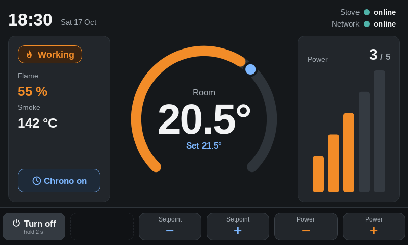
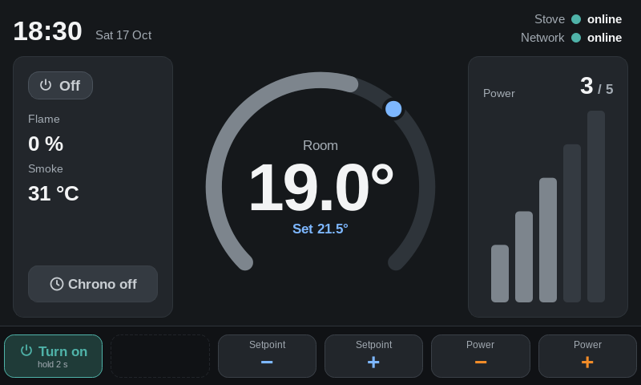
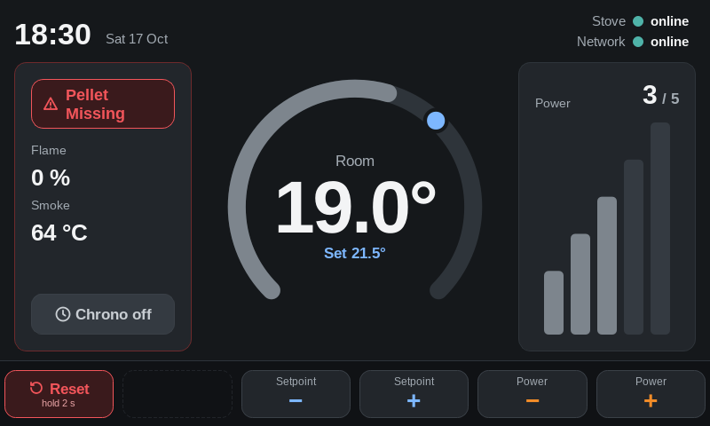
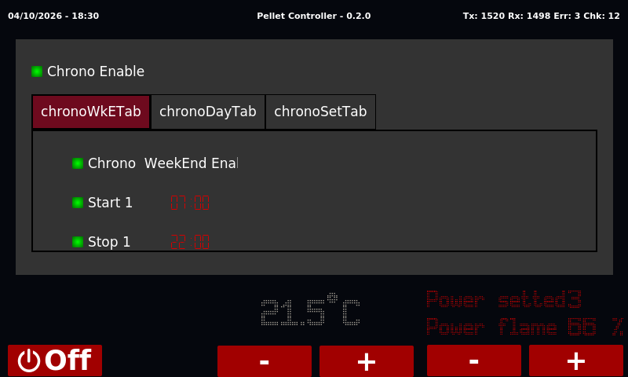
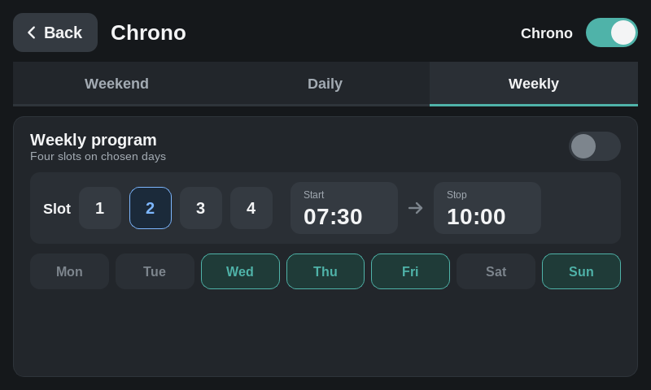
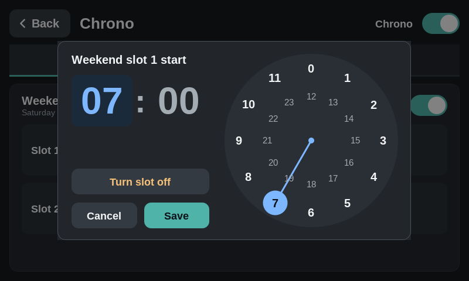
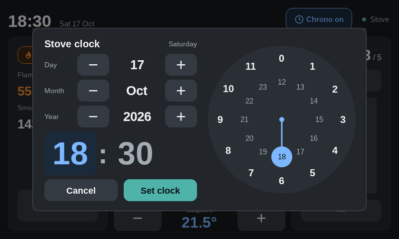
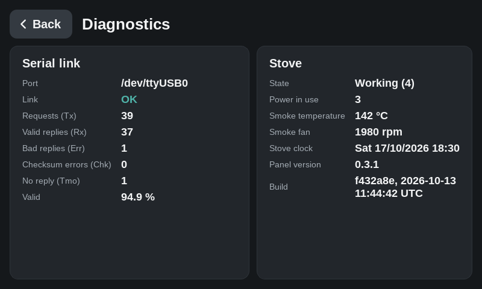

# Pellet Controller

Touch panel for a pellet stove, written in Qt 5 Widgets / C++17. It talks to
the stove board over a serial line: it shows the room temperature, the
stove state and the power, switches the stove on and off, changes the
setpoint and the power, and edits the stove chrono thermostat.

It runs on an 800x480 ARM display (32 or 64 bit) and on the desktop for
development.



## Features

- Main page: room temperature on a dial with the setpoint, stove state,
  flame power, smoke temperature, set power with bars, stove date and
  time, chrono on/off (a tap opens the chrono page), stove link and
  network status (network only with MQTT on)
- Key bar at the bottom of the main page, one keycap over each of the six
  keys under the screen of panels that have them (read as F1-F6), touch
  buttons on the others: 1 On / Off, Reset in the alarm states (both held
  for 2 s), 2 free, 3-4 setpoint -/+, 5-6 power -/+; the other pages and
  the dialogs are touch only
- Setpoint -/+ in 0.5 °C steps from 5 to 30 °C, power -/+ from 1 to 5,
  active once the stove answers
- Chrono page: chrono on/off; weekend and daily programs (on/off, two
  slots); weekly program (on/off, four slots, days of each slot); every
  start and stop set on a clock face or turned off; back to the main page
  after 10 s without touches
- Stove clock set from the panel (tap the clock): date -/+, time on a
  clock face to the minute
- Diagnostic page (tap the status rows): serial port and link, Tx / Rx / errors /
  checksum errors / timeouts, power in use, smoke fan, stove clock,
  version, Home Assistant connection
- Home Assistant through MQTT, read only: a "Pellet stove" device with the
  stove values, found by MQTT discovery (see [Home Assistant](#home-assistant))
- Serial link state: "No serial port" while the port is missing (opened
  again every 3 s, e.g. after the USB adapter is plugged back), "No reply"
  after 10 s without a valid reply
- Every write is verified (echo, checksum, value), sent again once, and
  reported on the panel if the stove does not confirm it

## Screenshots

| | |
|---|---|
|  |  |
| Stove off: key 1 turns it on | Pellet missing: Reset only |
|  |  |
| Chrono page, weekend program | Weekly program, slot 2 and its days |
|  |  |
| Time of a chrono slot on the clock face | Stove clock setting |
|  | |
| Diagnostic page | |

The screenshots are taken on the panel with the real pages fed by the
stove simulator (`tools/stovesim`).

## Repository layout

| Path | Content |
|---|---|
| `*.cpp`, `*.h` | The application sources (pages built in code, no `.ui` forms) |
| `qss/`, `icons/` | Style sheet and stroke icons, tinted at run time (`resources.qrc`) |
| `images/` | Boot splash of the panel, 800x480 (`splash.svg`, `splash.png` rendered with headless Chromium) |
| `app/app.pro` | Application project, sources taken from the root |
| `CustomWidgets/` | Custom widgets, static library |
| `ThirdParty/` | External modules as git submodules: Qt Serial Port and Qt MQTT 5.13.2, built static |
| `tools/stovesim/` | Stove board simulator on a pseudo terminal (Linux) |
| `tools/stovedump/` | Read only dump of the stove RAM and EEPROM |
| `tools/package/` | Deployment package for the panel launcher ([README](tools/package/README.md)) |
| `setting.default.ini` | Settings template, copied to `setting.ini` at the first start |
| `tests/` | Unit tests (QtTest): `SerialProto` against the simulator |
| `docs/` | [Serial protocol](docs/PROTOCOL.md), Home Assistant dashboard, screenshots |
| `PelletController.pro` | Top level `subdirs` project: ThirdParty, CustomWidgets, app (+ tests, tools) |
| `.qmake.conf` | `PC_SRC` and `PC_BUILD`, the source and build roots for every project |
| `version.pri` | Version from the latest git tag |

Application sources:

| File | Role |
|---|---|
| `main.cpp` | Startup: banner, one instance, SIGTERM/SIGINT = clean exit, `setting.ini` (created from the template), window frameless and maximized on the device |
| `singleinstance.*` | One instance per device (abstract unix socket) |
| `mainwindow.*` | The pages (`QStackedWidget`), back to the main page when idle, write failure message, clock setting |
| `mainpage.*` | Main page: clock, stove and network status, state card with the chrono button, dial with setpoint, power card, key bar |
| `chronopage.*` | Chrono page: chrono on/off, weekend, daily and weekly programs |
| `diagpage.*` | Diagnostic page: serial link and counters, stove values, version |
| `timepicker.*` | Time picker of the chrono slots (clock face, tens of minutes, slot off) |
| `clockdialog.*` | Stove clock setting (date -/+, clock face to the minute) |
| `uiicons.*` | SVG icons tinted with one color |
| `homeassistant.*` | Home Assistant through MQTT: settings, state, discovery |
| `serialproto.*` | `SerialProto` singleton: serial port, polling, read and write of the stove parameters |
| `common.h` | Name, version and banner, exit codes |

Custom widgets: `wDial` (temperature dial with the setpoint marker),
`wPowerBars` (power level bars), `wKeyCap` (keycap of the key bar, tap
or hold, driven by touch or by a physical key), `wToggle` (on/off switch that signals
only the user's taps), `wClockFace` (clock face to pick hours and
minutes with a finger).

## Serial protocol

Full description, with examples, parameter map, polling, writes and link
handling: [docs/PROTOCOL.md](docs/PROTOCOL.md) (HTML:
[docs/protocol.html](docs/protocol.html)).

`SerialProto` uses the port set in `setting.ini` (see [Build](#build),
default `/dev/ttyUSB0`) at 1200 baud, 8 data bits, no parity,
2 stop bits, no flow control. The line echoes what is sent, so every reply
starts with the request bytes: a reply whose echo differs from the request
is dropped and the parameter is read again once.

The stove exposes two banks of byte parameters:

| Bank | Code | Content |
|---|---|---|
| RAM | `0x00` | Live values: room temperature, state, flame power, smoke, clock |
| EEPROM | `0x20` | Settings: setpoint, power, chrono |

Messages:

| Message | Sent | Received (after the echo) |
|---|---|---|
| Read | `bank`, `address` | `checksum`, `value` with `checksum = bank + address + value` |
| Write | `0x80 + bank`, `address`, `value`, `0x80 + bank + address + value` | `0x80 + bank + address + value`, `value` |

All sums are modulo 256.

### Memory map

The stove board is a Micronova controller. The protocol is the same on
every Micronova board, the addresses are not: this map was checked on this
stove with `tools/stovedump` (see [Memory dump](#memory-dump)) in the Off
Pellet Loading, Ignition and Working states, against the stove display. Panel: R = read by
the polling (`requestsMap` in `serialproto.h`), W = also written.

RAM (bank `0x00`, live values):

| Address | Content | Encoding | Panel | Checked |
|---|---|---|---|---|
| `0x00` | Internal counter | 0-255, runs continuously | | yes |
| `0x01` | Room temperature | value / 2 °C | R | yes, 19.0 °C |
| `0x0D` | Auger on time | value / 10 | R | yes, 0 Off, 37 Pellet Loading |
| `0x19` | Power level in use (likely) | `0x90` Off, 1 Pellet Loading, 2 Working at power 2 | R | partly |
| `0x21` | Stove state | 0 Off, 1 Starting, 2 Pellet Loading, 3 Ignition, 4 Working, 5 Brazier Cleaning, 6 Final Cleaning, 7 Standby, 8 Pellet Missing, 9 Ignition Failure, 10 Alarm | R W | yes, 0 and 2 |
| `0x34` | Flame power | 0-16, shown as 10-100 % | R | yes, 0 Pellet Loading, 0-1 Ignition, 4 (32 %) Working at power 2 |
| `0x36` | Smoke fan speed requested (likely) | as `0x37` | | 0 Off, ~200 Pellet Loading |
| `0x37` | Smoke fan speed | value × 10 + 250 rpm | R | yes, 0 Off, ~2250 rpm Pellet Loading, ~1980 rpm Working |
| `0x5A` | Smoke temperature | °C | R | yes, 21 °C Off, 68-72 °C Ignition, 119 °C Working |
| `0x65`-`0x6B` | Clock | seconds, day of week (1 Monday), hours, minutes, day, month, year - 2000 | R | yes, actual date and time |
| `0x9B`-`0xC8` | Stove display text | ASCII, scrolling (e.g. `OFF`, "CARICA PELLET") | | yes |

EEPROM (bank `0x20`, settings):

| Address | Content | Encoding | Panel | Checked |
|---|---|---|---|---|
| `0x42` | Weekend program on/off | 0 / 1 | R W | yes, as on the display |
| `0x43`, `0x44` | Weekend slot 1 start, stop | tens of minutes from 00:00 (0-143), 144 = off | R W | yes, 03:00-06:00 |
| `0x45`, `0x46` | Weekend slot 2 start, stop | as above | R W | yes, 17:00-off |
| `0x47` | Daily program on/off | 0 / 1 | R W | yes |
| `0x48`-`0x4B` | Daily slot 1 and 2 start, stop | as above | R W | yes |
| `0x4C` | Chrono on/off | 0 / 1 | R W | yes |
| `0x50` | Weekly program on/off | 0 / 1 | R W | yes |
| `0x51`, `0x52` | Weekly slot 1 start, stop | as above | R W | yes, slot every 9 bytes |
| `0x53`-`0x59` | Weekly slot 1 days, Monday to Sunday | 0 / 1 | R W | yes |
| `0x5A`-`0x62` | Weekly slot 2: start, stop, days | as slot 1 | R W | yes, 07:30-10:00 Wed Thu Fri Sun |
| `0x63`-`0x6B` | Weekly slot 3: start, stop, days | as slot 1 | R W | yes, 08:00-09:30 Sun |
| `0x6C`-`0x74` | Weekly slot 4: start, stop, days | as slot 1 | R W | |
| `0x7D` | Setpoint | value / 2 °C, the panel writes 10-60 (5.0-30.0 °C) | R W | yes, 45 = 22.5 °C on the display |
| `0x7F` | Power | 1-5 | R W | yes, 2 |
| `0xF8`-`0xFD` | Clock to set | day of week (1 Monday), hours, minutes, day, month, year - 2000, BCD | W | yes, read and written |

Other published Micronova maps (clock at `0x63` or `0x7B`, smoke
temperature at `0x3E`, setpoint 1:1, weekly slots every 10 bytes) do not
apply to this board: see
[docs/PROTOCOL.md](docs/PROTOCOL.md#other-micronova-boards).

On / Off writes the state: Starting to switch on, Final Cleaning to switch
off, Off for the Reset after an alarm.

Polling: one parameter every 200 ms, the stove state every other request,
a 2 s pause after each round. On the chrono page only the chrono
parameters are read. The I/O is non-blocking: a reply is complete when the
line stays idle for 100 ms, writes are queued and sent one at a time.

## Home Assistant

The panel publishes the stove values to an MQTT broker and announces them
to Home Assistant with MQTT discovery: a device "Pellet stove" appears in
the MQTT integration. Read only: Home Assistant cannot switch the stove,
change the setpoint or the power, reset an alarm or edit the chrono.

`setting.ini`, as RoomSense and AcquaThermoNet (without `broker_addr` MQTT
is off and the panel works as before):

```ini
[MQTT]
broker_addr=192.0.2.10
broker_port=1883
; used only when both are set
broker_uname=
broker_password=
; topics PelletController/<unique_id>/..., client id PelletController-<unique_id>
; (empty: the host name)
unique_id=stufa
```

Entities:

| Entity | Type | From |
|---|---|---|
| Room temperature, Setpoint, Smoke temperature | sensor, °C | RAM `01`, EEPROM `7D`, RAM `5A` |
| State | sensor | RAM `21` ("Working", "Off", "Pellet Missing", ...) |
| Alarm | binary sensor, problem | states 8-10 |
| Flame | sensor, % | RAM `34` |
| Smoke fan | sensor, rpm | RAM `37` |
| Power, Power in use | sensor | EEPROM `7F`, RAM `19` (0 when none) |
| Stove link | binary sensor, connectivity | port open and the stove answering |

Topics (`<base>` = `PelletController/<unique_id>`):

| Topic | Retained | Payload |
|---|---|---|
| `<base>/status` | yes | `online` at the connection, `offline` as last will and at exit |
| `<base>/link` | yes | `online` while the stove answers, `offline` otherwise |
| `<base>/state` | yes | one JSON object with all the values, `null` until read; sent when it changes, at most every 10 s |
| `homeassistant/<sensor or binary_sensor>/PelletController_<unique_id>_<key>/config` | yes | discovery, sent at the connection and when `homeassistant/status` becomes `online` |

```json
{"room_temp":20.5,"setpoint":21.5,"state":"Working","state_code":4,"alarm":false,
 "flame":55,"smoke_temp":142,"smoke_fan":1980,"power":3,"power_in_use":3,"link":true}
```

Every entity is unavailable while the panel is offline; all but "Stove
link" also while the stove does not answer. The client reconnects by
itself (after 1, 2, 5, 10, then every 30 s); the diagnostic page shows the
MQTT state, the broker and the messages sent.

A ready dashboard (standard cards: state, alarm, gauges, last 24 hours):
[docs/homeassistant-dashboard.yaml](docs/homeassistant-dashboard.yaml), to
paste in the raw configuration editor of a new dashboard.

## Build

Requirements: Qt 5.13.2 (desktop) or the ARM SDK of the panel, and the
submodules:

```sh
git submodule update --init
```

Open `PelletController.pro` in Qt Creator, or build out of the source tree:

```sh
mkdir -p build/desktop && cd build/desktop
<Qt 5.13.2>/bin/qmake ../../PelletController.pro
make -j8
./bin_x86_64/PelletController
```

The build runs in order:
1. `ThirdParty`: Qt Serial Port from `ThirdParty/qtserialport` and Qt MQTT
   from `ThirdParty/qtmqtt` (Home Assistant), built static
   with the qmake in use, only when the library is missing (after changing
   the submodule, delete `<build>/ThirdParty`)
2. `CustomWidgets`: `libcustomwidgets.a`
3. `app`: the application, linked with both, in `<build>/bin_<arch>/`

No shared library to deploy besides Qt itself: the panel does not have
`libQt5SerialPort` nor `libQt5Mqtt`.

The target comes from `QT_ARCH`: `x86_64` builds the desktop version
(800x480 window), `arm` and `arm64` build the frameless full screen version
(`DEVICE` define in `app/app.pro`).

The application opens the serial port at startup and keeps trying every
3 s while it is missing: without the stove the values stay at `--`. The
port is read from `setting.ini` in the working directory, created from
`setting.default.ini` (copied next to the binary by the build) when it is
missing:

```ini
[SERIAL]
port=/dev/ttyUSB0
```

Optional qmake arguments:

| Argument | Builds |
|---|---|
| `CONFIG+=tests` | `tests/tests`, see [Tests](#tests) |
| `CONFIG+=tools` | `tools/stovesim` (see [Stove simulator](#stove-simulator)) and `tools/stovedump` (see [Memory dump](#memory-dump)) |

ARM builds also write the deployment package for the panel launcher
(JMLauncher) to `<build>/dist/`: see [Install on the panel](#install-on-the-panel).

## Install on the panel

The package `PelletController_Package_Arm32_<version>.zip` is installed
by the launcher of the panel, which then starts the application at boot
and restarts it if it crashes ([tools/package/README.md](tools/package/README.md)).
The application runs in the package folder `deploy/`: on the first start
it creates `deploy/setting.ini` from the template (port `/dev/ttyUSB0`,
MQTT off); edit it (broker for Home Assistant) and restart. An update
keeps `setting.ini`.

Exit status, for the restart loop: `0` stopped on purpose (SIGTERM or
SIGINT: MQTT offline, port closed), `3` another instance is already
running on the panel (not restarted), anything else a crash (restarted).
`PelletController --version` prints the banner
(`Pellet Controller vX.Y.Z (git <hash>, built <UTC time>)`).

## Version

The version comes from the latest git tag reachable from the built commit
(`version.pri`): `v0.1.0` gives `0.1.0`, a later commit `0.1.0-<hash>`,
no tag `0.0.0`. It is read when qmake runs: rerun qmake after a commit or a
tag. A release is just an annotated tag:

```sh
git tag -a vX.Y.Z -m vX.Y.Z
```

## Stove simulator

`tools/stovesim` (Linux) answers like the stove board on a pseudo terminal
reached through a symlink, so the application runs on the desktop without a
stove. It echoes every request, answers reads and stores writes in a RAM and
an EEPROM bank with the values of a stove switched off (20.0 °C, setpoint
22.5 °C, power 2, chrono on, weekend slot 1 07:00-22:00). Starting moves to
Working and Final Cleaning to Off after 10 s.

```sh
qmake PelletController.pro CONFIG+=tools && make
./tools/stovesim/stovesim --link /tmp/pellet-stove      # -v: print every read
```

Then, in the directory the application is started from, `setting.ini`:

```ini
[SERIAL]
port=/tmp/pellet-stove
```

Commands on the simulator's standard input: `state <n>`, `temp <C>`,
`setpoint <C>`, `power <n>`, `mute on|off` (echo only), `corrupt <n>`
(wrong checksums), `echo <n>` (wrong echoes), `writes on|off` (writes not
stored), `unplug` / `plug` (port removed and back), `show`, `quit`.

## Memory dump

`tools/stovedump` reads every RAM and EEPROM location of the stove and
prints them as a hex grid with an ASCII column (and optionally a CSV). It
only sends read requests: there is no code in it that builds a write. Each
location is read up to 3 times; `--` means no reply, `??` a bad reply. A
full dump takes about a minute. Stop the application first: the port can
be used by one program at a time.

```sh
./stovedump --port /dev/ttyUSB0 --bank both --csv dump.csv
./stovedump --bank ram --from 80 --to 9F
```

Useful to check the parameter map of a stove model against
[docs/PROTOCOL.md](docs/PROTOCOL.md).

## Tests

`tests/` (QtTest, Linux) runs `SerialProto` against the simulator, with the
real timings (one request every 200 ms), in about 80 s: polling sequence,
checksum and echo errors with one retry, stove not answering, write
verified and write not stored, setpoint limits, port unplugged and plugged
back, chrono round and writes, stove clock, flame power. No real port is used. On a busy machine
the simulator can answer late: the tests that check an exact request
sequence are then skipped (`SKIP`, "simulator replies late"), not failed.
`DEFINES+=SIM_REPLY_DELAY=<ms>` changes the simulator reply delay
(default 40 ms).

The Home Assistant tests check the settings, the topics, the discovery
(no command topic) and the state JSON, without a broker. One test
function: `./tests/tests <name>` (passed only to the class that has it).

```sh
qmake PelletController.pro CONFIG+=tests && make
./tests/tests
```
